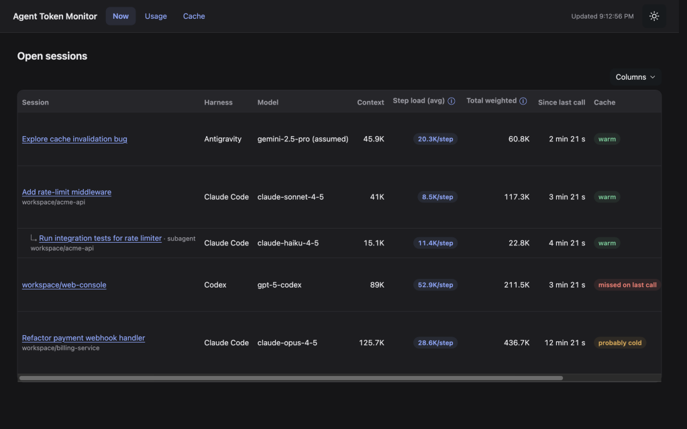
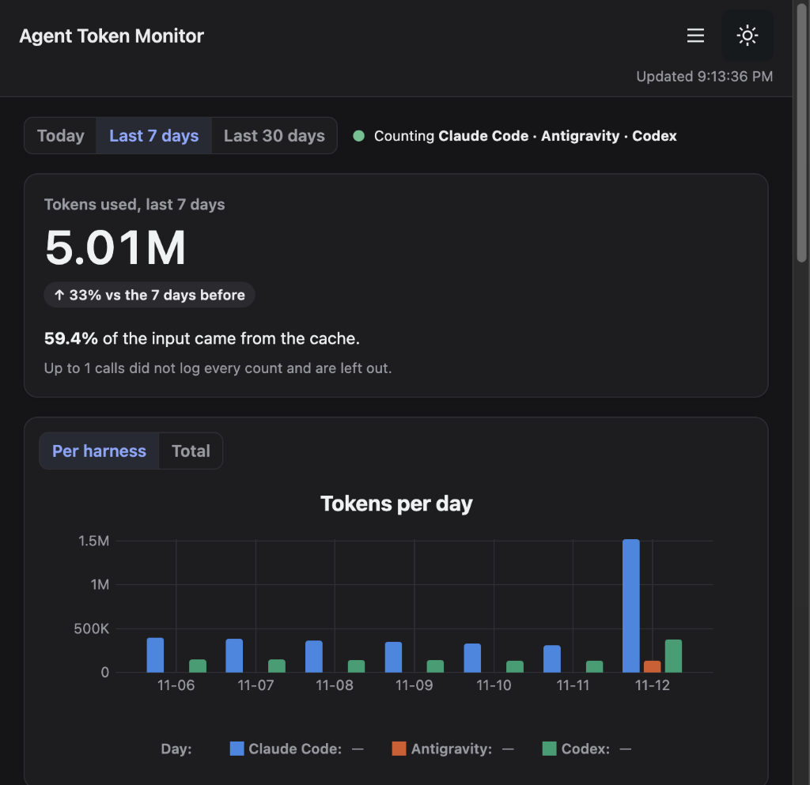
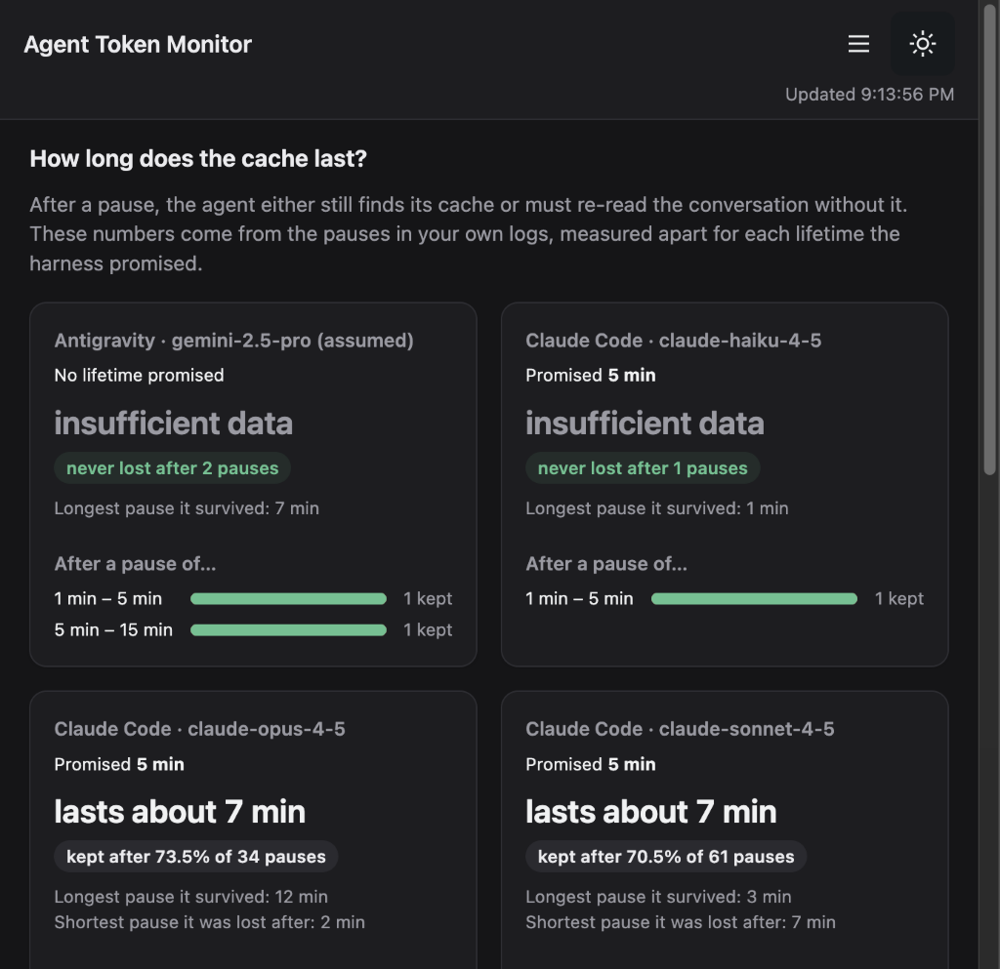
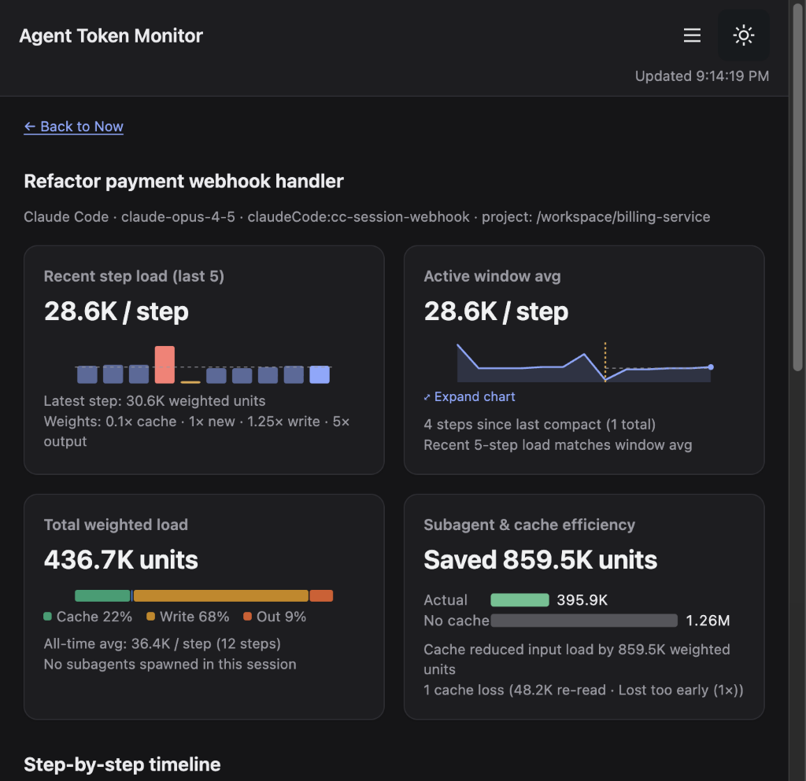

# agent-token-monitor

**See exactly where your AI coding agent's tokens go — live, per session, per day, per month. Computed deterministically from the logs already on your disk.**

[](https://github.com/yyilmaz/agent-token-monitor/actions/workflows/ci.yml)
[](LICENSE)
[](package.json)

[Quick start](#quick-start) · [Dashboard tour](#dashboard-tour) · [Supported harnesses](#supported-harnesses) · [How analysis works](#how-analysis-works) · [Configuration](docs/configuration.md) · [Contributing](#contributing)

<p align="center">
  
</p>
<p align="center">
  <em>Local dashboard (<code>Now</code> view, rendered from synthetic fixture logs — no real user data).</em>
</p>

---

## Why this exists

An AI coding agent can silently re-read an entire long session after its prompt cache expires. Compaction adds a summarization request and may force the agent to re-read files. Raw token totals alone never tell you which of those happened.

**agent-token-monitor makes it visible.** Without spending a single extra token or sending anything over the network, it answers:

1. **Right now:** Which sessions are open, how large their context is, whether their cache is warm or probably cold, and whether to keep going, compact, or start fresh.
2. **Over time:** How many tokens you used today, over 7 days, and over 30 days — split by harness, model, and project.
3. **Why tokens spiked:** Which session, which step, and which cause (`idleBeyondLifetime`, `compaction`, `modelSwitch`, or `prematureLoss`) triggered a cache loss.

---

## Core principles

| Principle | What it means |
|---|---|
| **Deterministic** | Same log files in, same numbers out, every time. No LLM calls, no sampling, no heuristics that drift between runs. Every number traces back to a log line. |
| **Zero tokens** | Analysis never calls a model. Watching your usage consumes zero tokens. |
| **Local-only, no secrets** | Reads local log files only. **No API keys, no credentials, no network calls, no telemetry.** Nothing leaves `127.0.0.1`. |
| **Exact or explicitly `unknown`** | If a log omits a field (such as Antigravity's model name or hidden `/compact` tokens), the UI shows `unknown`. It never estimates or interpolates. |
| **Read-only** | Pure observer. Never creates, modifies, locks, or deletes any harness file or setting. |
| **Harness-agnostic** | One normalized data model; each harness is a small, swappable adapter. |

---

## Quick start

**Requirements:** macOS (default log paths) and **Node.js 22.12+**. There is no package to install — clone and run locally:

```bash
git clone https://github.com/yyilmaz/agent-token-monitor.git
cd agent-token-monitor
npm ci
npm start
```

`npm start` compiles TypeScript and serves the dashboard at **`http://127.0.0.1:4317`**.

### CLI & configuration options

| Command / Flag | Description |
|---|---|
| `npm start` | Build and serve the dashboard on `http://127.0.0.1:4317` |
| `node dist/src/hosts/node/main.js --port 8080` | Serve on a custom port (use `--port 0` for an OS-assigned free port) |
| `node dist/src/hosts/node/main.js --config <path>` | Load a custom user configuration file |
| `npm run build && npm run status` | Print the current JSON overview (`Now` + `ADVICE-1` + `WORKFLOW-1`) to stdout and exit |

The server binds to `127.0.0.1` only and rejects requests with any other `Host` header ([ADR 0013](docs/adr/0013-server-data-api-and-dashboard.md)). For custom log directories (including Linux/Windows paths), assumed models, or cache thresholds, see [docs/configuration.md](docs/configuration.md).

---

## Dashboard tour

The local HTML dashboard refreshes automatically, works completely offline, follows your system light/dark theme (with a navbar toggle), and remembers column visibility preferences in your browser ([ADR 0019](docs/adr/0019-bootstrap-navbar-and-color-modes.md)).

### Now — Open sessions & live advice

Lists sessions active within the configured window (`openWithinSeconds`, default 30 min) with nested subagents and side sessions, current context size, time since last call, cache status (`warm`, `probably cold`, `missed on last call`), deterministic session advice (**keep going**, **compact now**, or **start fresh** via `ADVICE-1`), and workflow split metrics (`WORKFLOW-1`, [ADR 0017](docs/adr/0017-session-advice.md)).

### Usage — Daily trends & breakdowns

<p align="center">
  
</p>

Totals and daily bar charts for **Today**, **Last 7 days**, and **Last 30 days**, with per-harness and combined views for input, output, and weighted token units, plus breakdowns by harness, model, or project.

### Cache — Observed lifetimes & miss causes

<p align="center">
  
</p>

Compares promised vs. observed cache lifetimes per harness and model, shows survived vs. lost counts across pause-duration bands, and attributes lost tokens to each deterministic miss cause.

### Session drill-down — Step-by-step timeline

<p align="center">
  
</p>

Inspects any session step by step: context growth, cache hit share, compaction boundaries, cache-savings summary, every cache miss with its cause, and the subagent tree.

---

## Supported harnesses

Each adapter normalizes a harness's native logs into a single shared model and is pinned by anonymized fixture tests.

| Harness | Status | Default log location (macOS) | Key notes |
|---|---|---|---|
| **Antigravity** (2.0 app) | Supported | `~/.gemini/antigravity/brain/<id>/.system_generated/logs/transcript.jsonl` | Titles from `annotations/<id>.pbtxt`; model & `/compact` tokens are `unknown` |
| **Claude Code** | Supported | `~/.claude/projects/<encoded-cwd>/<session-id>.jsonl` | Deduplicates streamed `requestId` lines and forked sessions; tracks 5m/1h cache writes |
| **Codex** | Supported | `~/.codex/sessions/YYYY/MM/DD/rollout-*.jsonl` | Normalizes `input_tokens` (which includes cached tokens); retains logged quota samples |
| **OpenCode** | Planned | `~/.local/share/opencode/opencode.db` | SQLite store; requires strictly read-only access without touching `-wal`/`-shm` (R-15) |

<details>
<summary>Adapter normalization details &amp; per-call field semantics</summary>

Field semantics differ significantly between harnesses. Adapters normalize these differences explicitly:

- **Antigravity:** Each `PLANNER_RESPONSE` step is one request. `input_tokens` represents uncached prompt tokens, and there is no cache-write field, so cache writes are recorded as `0`. Model name and thinking tokens are not logged (`unknown`). `/compact` writes a `CHECKPOINT` step with no token counts (`unknown`). Subagents are separate conversations linked by `.system_generated/subagents/<child-id>.json`. Other Antigravity log directories can be added via `logRoots.antigravity`.
- **Claude Code:** One request is written across multiple streaming lines sharing a `requestId`; the adapter counts it once (taking the largest output). `input_tokens` already excludes cached tokens. `cache_creation_input_tokens` splits 5m (`300s`) and 1h (`3600s`) ephemeral writes. Subagents live under `<session-id>/subagents/agent-<id>.jsonl`. Compaction (`compact_boundary`) does not log its summarization tokens (`unknown`).
- **Codex:** Counts each `token_usage_record` once and supports older `token_count` snapshots ([ADR 0018](docs/adr/0018-codex-adapter.md)). Codex's `input_tokens` **includes** cached tokens, so the adapter subtracts `cached_input_tokens` and `cache_write_input_tokens` to compute `input_uncached`. Logged rate limits are preserved as quota samples.
- **OpenCode:** Currently checks for the presence of `opencode.db` only and never opens it, because opening SQLite normally can create or modify `-wal` / `-shm` sidecar files in the harness directory, which violates the read-only rule (R-15).

</details>

---

## How analysis works

### Normalized data model

Every adapter emits the same core record types:
- **Session:** harness, session ID, parent session (for subagents), project / working directory, model(s), first and last activity.
- **Call:** timestamp, session, model, `input_uncached`, `cache_read`, `cache_write`, `output`, `reasoning` (each `int` or `unknown`), tool calls, and context size (`input_uncached + cache_read + cache_write`).
- **Event:** compaction, model switch, user turn, subagent spawn, error.
- **Quota sample** *(where logged)*: source, window, used percent, reset time.

### Weighted token units

Weighted token units estimate relative processing load using `1` uncached input token as the reference unit:

```text
round(uncached input × 1 + cache read × 0.1 + cache write × 1.25 + output × 5)
```

For example, `100` uncached input + `500` cache read + `20` cache write + `20` output = **275 weighted token units**. Missing fields are omitted from the sum; if all four are missing, the call's weighted load is `unknown`. Weights are configurable under `rules.sessionAdvice.weights` ([docs/configuration.md](docs/configuration.md#rules), [ADR 0017](docs/adr/0017-session-advice.md)).

### Deterministic cache-miss classification

A call is a **full cache miss** when it reads `0` from cache above `fullMissMinContextTokens`. It is a **cache loss** when it is a full miss or reads less than `survivedMinCacheReadShare` of the previous context from cache. Each cache loss receives exactly one cause from ordered rules over the log alone ([ADR 0009](docs/adr/0009-cache-classification-lifetime-and-miss-causes.md)):

1. `modelSwitch` — the model changed since the previous call in the session.
2. `compaction` — a compaction occurred since the previous call.
3. `idleBeyondLifetime` — the pause since the previous call exceeds the declared (or observed) cache lifetime.
4. `prematureLoss` — any other loss, including unexpected mid-session expirations.

---

## Roadmap & out of scope

**Shipped:** Antigravity, Claude Code, and Codex adapters · live `Now` view with `ADVICE-1` & `WORKFLOW-1` · `Usage` & `Cache` views · session drill-down · `--status` JSON CLI · diagnostics.

**Planned:**
- OpenCode strictly read-only SQLite adapter (R-21)
- Self-contained HTML report export (R-71, [ADR 0002](docs/adr/0002-architecture-and-boundaries.md))
- Native VS Code extension host packaging (R-26)

**Intentionally out of scope:**
- **Controlling agents:** This is a pure observer. It never modifies settings, triggers `/compact`, or alters agent behavior.
- **Quota dashboards:** The dashboard focuses on token counts (though the Codex adapter preserves logged quota samples in the normalized model).
- **Reading prompt/code content:** Only metadata needed for classification is read. Session titles, subagent descriptions, and project paths may appear in the local UI/API — review screenshots or JSON output before sharing.

---

## Contributing

Contributions are welcome — especially new harness adapters with anonymized log fixtures and unit tests. See [CONTRIBUTING.md](CONTRIBUTING.md) for the workflow and [SECURITY.md](SECURITY.md) for reporting vulnerabilities.

```bash
npm ci      # install locked dev dependencies
npm test    # compile with tsc and run node --test
```

**Architecture & docs:**
- [docs/SRS.md](docs/SRS.md) — product requirements and open questions
- [docs/adr/](docs/adr/README.md) — Architecture Decision Records (including [project layout](docs/adr/0006-project-layout-and-tooling.md))
- [docs/configuration.md](docs/configuration.md) — full configuration schema

GitHub Actions CI runs `npm test` on macOS with Node.js 22.12, audits the npm lockfile, and runs Gitleaks on PRs and pushes to `main`.

## License

[MIT](LICENSE)
